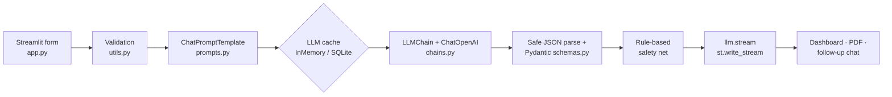

# 🩺 MediGuide AI

**AI-Powered Medical Symptom Assessment and Patient Guidance Assistant**
Final-year / LangChain programming project built with **LangChain · OpenAI · Streamlit · Pydantic · Plotly · ReportLab**.

> ⚠️ **Medical & safety notice.** MediGuide AI is an **educational prototype only**. It is NOT a doctor,
> never gives a confirmed diagnosis, does not replace professional medical care and must never be used in
> an emergency. In an emergency, call your local emergency number immediately.

---

## ✨ Features

**Core (assignment requirements)**
- Patient form: age, gender, symptoms (multiselect + free text), duration, severity slider, conditions, medications, notes, answer language.
- `LLMChain` + `ChatOpenAI` returns **structured JSON** (summary, possible conditions, urgency, next steps, doctor questions, warning signs).
- Live **streaming** narrative (`llm.stream()` → `st.write_stream`).
- **InMemoryCache** and **SQLiteCache**, switchable from the sidebar.
- Colour-coded urgency (LOW / MEDIUM / HIGH / EMERGENCY) and disclaimers on every screen.

**Professional extras**
| Feature | Tool |
|---|---|
| Schema validation / auto-repair of model JSON | Pydantic v2 (`src/schemas.py`) |
| Rule-based **safety net** that can raise urgency for danger signs | `src/utils.py` |
| Follow-up **chat with memory** (System + Human + AI messages) | LangChain messages |
| **Voice input** (speech → symptoms) | OpenAI Whisper + `st.audio_input` |
| Severity and urgency **gauges**, **analytics dashboard** | Plotly |
| **PDF** and Markdown report download, CSV export of history | ReportLab |
| One-click **demo scenarios** for presentations | sidebar |
| Light / dark theme, custom CSS, architecture diagram | Streamlit |
| Offline unit tests + CI | pytest, GitHub Actions |
| Container deployment | Docker, docker-compose |

## 🏗️ Architecture



```
medical_ai_assistant/
├── app.py                  # Streamlit UI (run this)
├── requirements.txt        # runtime dependencies
├── requirements-dev.txt    # + pytest
├── .env.example            # copy to .env and add your key
├── Dockerfile · docker-compose.yml · .dockerignore
├── .streamlit/config.toml  # theme
├── .github/workflows/ci.yml
├── src/
│   ├── config.py           # settings, options, disclaimers, demo scenarios
│   ├── prompts.py          # PromptTemplate, ChatPromptTemplate, JSON schema
│   ├── chains.py           # ChatOpenAI, LLMChain, streaming, chat, voice
│   ├── cache_manager.py    # InMemoryCache + SQLiteCache
│   ├── schemas.py          # Pydantic validation of the model's JSON
│   ├── report.py           # PDF report (ReportLab)
│   └── utils.py            # safe JSON parsing, validation, safety net
├── tests/                  # offline tests (no API key needed)
└── docs/
    ├── Medical_AI_Assignment.pdf
    └── PRESENTATION_GUIDE.md   # demo script + viva Q&A
```

## 🚀 Setup

```bash
python -m venv .venv
.venv\Scripts\activate            # macOS/Linux: source .venv/bin/activate
pip install -r requirements.txt

copy .env.example .env            # macOS/Linux: cp .env.example .env
# edit .env  ->  OPENAI_API_KEY=sk-...

streamlit run app.py
```

Get a key at <https://platform.openai.com> → *API keys*. **Never commit `.env`** (it is in `.gitignore`).

### Docker

```bash
cp .env.example .env              # add your key
docker compose up --build         # open http://localhost:8501
```

## 💾 Caching: InMemoryCache vs SQLiteCache

`set_llm_cache(...)` registers one global cache. LangChain checks it before every model call:
a **hit** returns the saved answer instantly (no API cost); a **miss** calls the model and stores the answer.

| | InMemoryCache | SQLiteCache |
|---|---|---|
| Stored in | RAM (memory) | A file on disk (`.cache/mediguide_cache.db`) |
| Speed | Fastest | Fast, slightly slower |
| Survives restart? | No | Yes |
| Best for | One session | Reusing answers across sessions |

LangChain's global cache is not consulted by `.stream()`, so `stream_narrative()` reads/writes the **same
registered cache** by hand. An identical form submitted twice is therefore fast for the JSON assessment
*and* the streamed narrative.

## 🛡️ Safety design

- Disclaimers in the sidebar, above every tab, in the results, in the PDF/Markdown reports.
- The system prompt forbids confirmed diagnoses, medicine doses and prompt-injection from patient text.
- Unknown / invalid urgency values fall back to a cautious `MEDIUM`.
- A rule-based safety net can **raise (never lower)** the urgency, e.g. chest pain + breathlessness, self-harm phrases, fever in a toddler.
- Invalid JSON never crashes the app: a friendly message plus the raw output is shown.
- Logs contain timings only, **never patient data**.

## ✅ Test scenarios

Use the **Demo scenarios** buttons in the sidebar.

| # | Input | Expected |
|---|---|---|
| 1 | Age 25, runny nose + sore throat, severity 2 | LOW |
| 2 | Age 40, fever + cough, 4-7 days, severity 6 | MEDIUM / HIGH |
| 3 | Chest pain + shortness of breath | HIGH / EMERGENCY (safety net forces EMERGENCY) |
| 4 | Submit the same form twice (cache on) | Second run is much faster |
| 5 | Empty symptoms → press Analyse | Warning, no API call |
| 6 | Language = Urdu | Guidance in Urdu (PDF falls back to Markdown for non-Latin scripts) |

Automated tests (no API key needed):

```bash
pip install -r requirements-dev.txt
python -m pytest -q
```

## ⚠️ Limitations & future work

- Not a medical device; answers can be wrong. Never use for real diagnosis or emergencies.
- PDF export supports Latin-script languages only (bundling a Unicode font would add Urdu/Arabic).
- The cache is process-wide; a multi-user deployment should add user isolation.
- Ideas: retrieval-augmented answers from vetted medical sources (RAG), user accounts, evaluation set with clinician review.

## 🔧 Troubleshooting

- **`No module named 'langchain.globals'`** – you have LangChain 1.x; this project already imports from `langchain_core.globals`. Run `pip install -r requirements.txt`.
- **`No module named 'langchain_classic'`** – `pip install langchain-classic` (needed for `LLMChain` on LangChain 1.x).
- **"No valid API key"** – make sure `.env` is in the project root with `OPENAI_API_KEY=sk-...`, then restart.
- **Voice box missing** – needs Streamlit ≥ 1.39 (`pip install -U streamlit`).

---
*Educational use only. MIT licensed. Not a medical device.*
